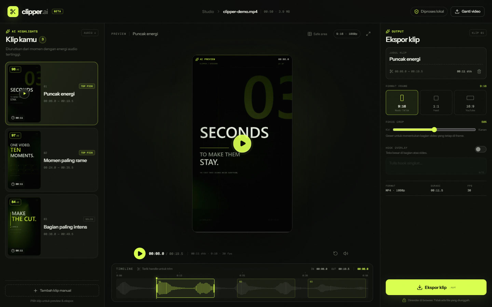

# Clipper AI

Studio pemotong video yang berjalan sepenuhnya di browser. Unggah satu video,
Clipper AI menganalisis energi audio, menemukan momen paling kuat, lalu
menyiapkan klip vertikal yang bisa langsung diekspor.



## Fitur

- **Upload lokal** — video tidak pernah dikirim ke server.
- **Deteksi highlight** — memindai waveform audio, memberi skor pada setiap
  kandidat, dan memilih klip yang tidak saling tumpang tindih.
- **Preview vertikal** — frame 9:16, 1:1, atau 16:9 dengan fokus crop horizontal.
- **Trim manual** — tarik handle di timeline atau buat klip manual baru.
- **Hook overlay** — teks besar yang dibakar ke video saat ekspor.
- **Ekspor nyata** — merender klip 1080p memakai Canvas + MediaRecorder,
  lengkap dengan audio. Format mengikuti dukungan browser (MP4/H.264 di Chrome
  modern, fallback WebM).
- **Responsif** — studio tetap bisa dipakai di layar ponsel.

## Menjalankan

```bash
npm install
npm run dev
```

Buka `http://127.0.0.1:5173`. Gunakan Chrome atau Edge terbaru untuk hasil
ekspor MP4 yang paling mulus.

Build produksi:

```bash
npm run build
npm run preview
```

## Cara kerja

1. **Metadata** dibaca lewat elemen `<video>` sementara.
2. **Audio** didekode dengan Web Audio API (`decodeAudioData`), lalu dihitung
   RMS per 100 ms. Noise floor dinormalisasi agar bagian sunyi tidak mendominasi.
3. **Kandidat klip** diberi skor dari rata-rata energi + puncak energi. Kandidat
   terbaik dipilih dengan jarak minimum agar klip tidak bertumpuk.
4. **Thumbnail** diambil dari 45% durasi klip, disimpan sebagai data URL.
5. **Ekspor** menggambar frame video ke canvas 1080p sesuai rasio dan posisi
   crop, menambahkan hook overlay, lalu merekam canvas + audio Web Audio dengan
   `MediaRecorder`.

Tidak ada model machine learning atau API eksternal di prototipe ini. Skoring
highlight berbasis sinyal audio; lapisan transkripsi/LLM bisa ditambahkan tanpa
mengubah alur editor.

## Struktur

```text
src/
  components/        UI studio, upload, timeline, export panel
  lib/analysis.ts    deteksi highlight + waveform
  lib/exporter.ts    render canvas + MediaRecorder
  lib/media.ts       metadata, thumbnail, helper canvas
  lib/canvas.ts      hook overlay dan dimensi output
  App.tsx            alur upload → analisis → editor
  styles.css         design system dan layout responsif
public/demo.mp4      video contoh 50 detik
```

## Catatan prototipe

- File besar akan memakai memori sesuai ukuran video karena audio didekode di
  browser. Untuk video panjang, gunakan file di bawah beberapa ratus MB.
- Deteksi highlight belum memahami isi pembicaraan. Ia mencari momen dengan
  energi audio tinggi, yang biasanya berkorelasi dengan tawa, penekanan, atau
  perubahan nada.
- Durasi ekspor bisa sedikit lebih panjang dari durasi klip karena jeda flush
  MediaRecorder, dan frame rate mengikuti performa perangkat.
- Video contoh dibuat khusus untuk demo. Semua video pengguna tetap berada di
  perangkat.
